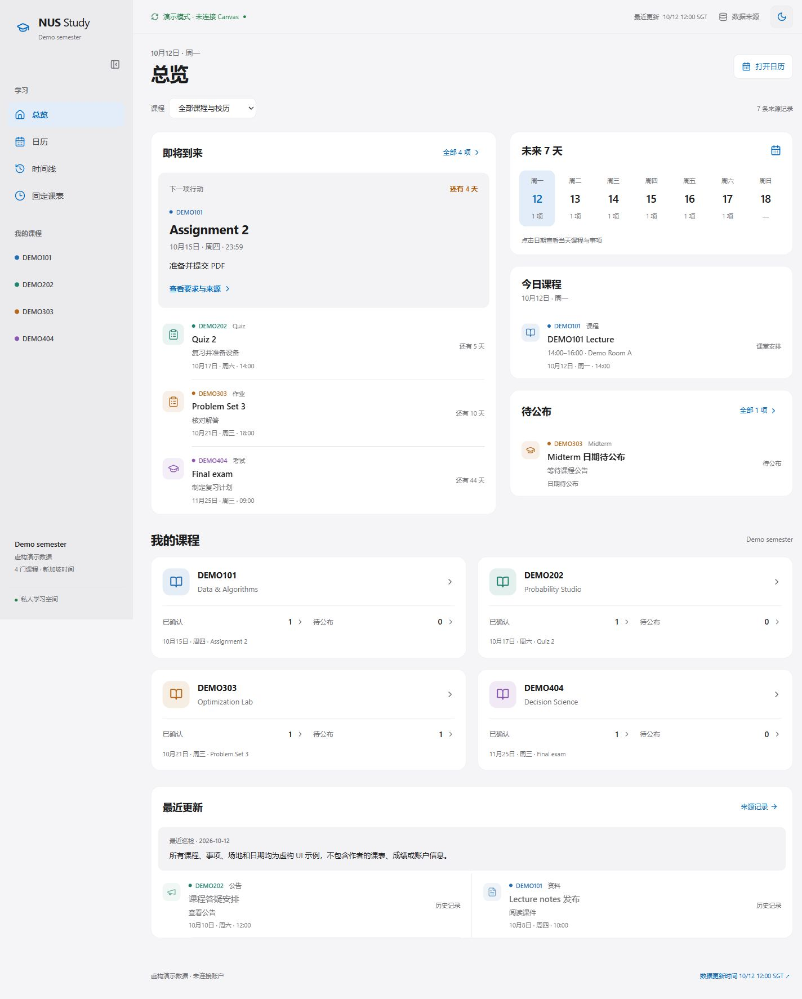
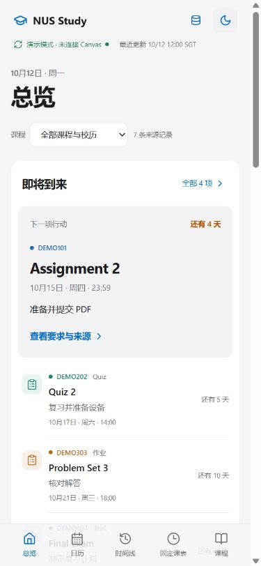

# NUS Canvas Dashboard

[English](README.md) | [简体中文](README.zh-CN.md)

An Apple-inspired, responsive course dashboard for deadlines, quizzes, course notices and a semester calendar. Built with Next.js, React and Tailwind CSS. Self-hosted and agent-friendly.

An independent student open-source project, not affiliated with or endorsed by NUS or Instructure.

## Preview

Screenshots use **fictional demo courses only**. No student identity, grades, real coursework or author account information is included.

### Desktop



### Mobile browser



## Run the demo in two minutes

Requires Node.js 22.13+ and npm. No Canvas account or credentials are needed for the demo.

```bash
git clone https://github.com/woodyhouse/nus-canvas-dashboard.git
cd nus-canvas-dashboard
npm ci
npm run dev
```

Open http://localhost:3000. `predev` creates an ignored `data/events.json` from `data/events.example.json` only when the local file does not exist; it never overwrites existing student data.

## Connect your Canvas account

**Important prerequisite:** login alone does not grant API access. Canvas requires an approved OAuth Developer Key for apps used by others. For hosted Canvas, your institution's administrator issues this key. This repository does not include a shared client secret and does not ask classmates to generate personal access tokens for a distributed application. See [Canvas OAuth documentation](https://developerdocs.instructure.com/services/canvas/oauth2/file.oauth).

This release includes a **single-user local OAuth client**. An institution must approve a client for the individual deployment and register its exact redirect URI. A shared institutional integration needs an administrator-managed backend; never distribute its client secret to every student.

Once that prerequisite is satisfied, an agent can handle installation, local configuration, synchronization, build and deployment. You personally complete Canvas login/MFA and approve OAuth access. Permission grants, platform authentication and any hosting charges remain explicit user decisions.

```bash
npm run setup
# Privately configure .env.local with your approved client ID and secret.
npm run canvas:login
# Open the printed Canvas authorization link; log in and approve access.
npm run canvas:sync
npm run dev
```

`canvas:login` listens only on `127.0.0.1:8787`, checks a random one-time OAuth state, exchanges the authorization code, and encrypts tokens in `.local/oauth.enc`. Its encryption key is kept in ignored `.env.local`. Restrict both files to your OS account; this protects against accidental disclosure, not a compromised computer. Nothing is sent to the author. API requests use GET only; OAuth token exchange and refresh use the necessary authentication POST endpoints.

Administrator scopes: allow only the GET endpoints needed for active courses, assignments (including the current user's submission), announcements, quizzes, modules and items, files, and calendar events. Enforce these scopes on the Developer Key. An unscoped token can have wider rights even though this app uses read-only API calls.

Without an approved key, use the demo or your own offline, normalized data. Agents must report this blocker honestly. They should not scrape browser-session secrets or create broad credentials to bypass it.

## What is automatic?

- Discover your active courses; no hard-coded course IDs.
- Paginate assignments, quizzes, announcements, modules, file metadata and calendar events.
- Normalize Canvas timestamps to Asia/Singapore and preserve historical events.
- Use your own submission record, never a class-wide submission flag.
- Record changed section hashes and changed events in `.local/last-check.json`.
- Refresh OAuth tokens when needed; keep credentials and personal data out of Git.
- Preserve the previous dashboard and baseline when a required section fails. Disabled Quizzes (403/404) are explicitly marked unavailable for browser follow-up.

## What still needs verification?

- PDF-only deadlines, exam venues, assessment weights, help-sheet and open/closed-book rules.
- Timetables and teaching-week exceptions absent from the API.
- Information mentioned only inside announcements: the app displays source text but does not guess dates from prose.
- Scheduled execution and automatic deployment: set up a local scheduler or an authorized agent automation. This repository does not silently install one.

The included agent skill gives a procedure for these checks. File metadata is tracked; this first release does not automatically download/OCR every slide. Only changed and relevant material should be extracted by your agent and cached locally. The optional `scripts/extract_pdf_text.py` caches text by SHA-256 and retains page numbers; install `pypdf`, with `pdftoppm` and `tesseract` for OCR, or let your agent use its own PDF tools. Unreadable pages remain explicitly unverified. Never upload instructors' copyrighted PDFs to the public repository.

## AI / agent setup prompt

Paste this into your coding agent after cloning:

```text
Set up this repository for my own Canvas courses. Read AGENTS.md and
skills/canvas-dashboard-setup/SKILL.md first. Install dependencies and verify
the demo before connecting. Check whether I have an institution-approved
OAuth Developer Key; if not, explain the prerequisite without inventing a
login-only solution. Keep credentials out of chat, Git and public artifacts.
I will complete login/MFA and OAuth approval myself. After authorization,
run read-only synchronization, review changed assessment sources, and verify
the dashboard on desktop and mobile. Ask me for my hosting destination and
keep any deployment containing real course data private. Explain remaining
manual steps and verify the final result rather than only proposing a plan.
```

For Codex, you may copy `skills/canvas-dashboard-setup` into your personal skill directory; other agents can read that SKILL.md directly. No particular AI vendor is required.

## Timetable and verified course-file facts

Create an ignored `data/overrides.local.json`:

```json
{
  "semester": "My semester",
  "calendar": {"start":"2026-08-10","end":"2026-11-13","excludedDates":[],"breaks":[]},
  "meetings": [{"course":"YOUR_CODE","weekday":1,"start":"14:00","end":"16:00","venue":"Your room","weeks":"1–13"}],
  "events": []
}
```

Use the actual `course_code` returned by Canvas. Weekday is 0=Sunday through 6=Saturday. Explicit slide facts belong in `events`, with a stable ID, type, title, date (or null), time, status, detail containing filename/page/source, and action. Preserve source conflicts visibly. Supported event types: assignment, quiz, midterm, exam, announcement, material, academic. Re-sync after editing overrides.

## Deployment and scheduled updates

```bash
npm test
npm run build
npm start
```

Run locally for the safest default. A Dockerfile is included for private self-hosting:

```bash
docker build -t canvas-dashboard .
docker run --rm -p 127.0.0.1:3000:3000 canvas-dashboard
```

The image contains the dashboard snapshot, **never OAuth credentials**. Treat images and build outputs containing your real courses as private. Add proper authentication before exposing them beyond your own device. The original author's hosting identity is not included.

After a successful `npm run canvas:sync`, rebuild and redeploy the same private instance. Do not commit real `data/events.json` to trigger deployment. A GitHub/Vercel build from the public repo intentionally shows demo data unless you securely supply your own snapshot outside Git. OAuth synchronization runs on your trusted local machine; a hosted callback/service is not bundled.

An agent may configure a 48-hour scheduler after you authorize it. Failed synchronization must not publish a falsely fresh snapshot. GitHub Actions here runs checks on demo data only; it does not access Canvas.

## Privacy and verification

- `.env.local`, `.local/`, real events and overrides are ignored.
- Only clean UI source and fictional examples are in Git history.
- No real screenshots, student IDs, emails, course IDs, grades, PDFs, cache, hosting IDs or old source history were copied.
- `npm run privacy:check` checks tracked paths and known personal/credential patterns. Visually inspect screenshots; regex checks cannot prove all sensitive content is absent.
- `npm test` exercises deadline conversion, personal-submission semantics and safe API pagination.
- OAuth integration requires an approved live key and is **not end-to-end verified against a real institutional OAuth app** in this release.

## License

MIT. No official university endorsement. Your institution's policies and Canvas API terms still apply.
